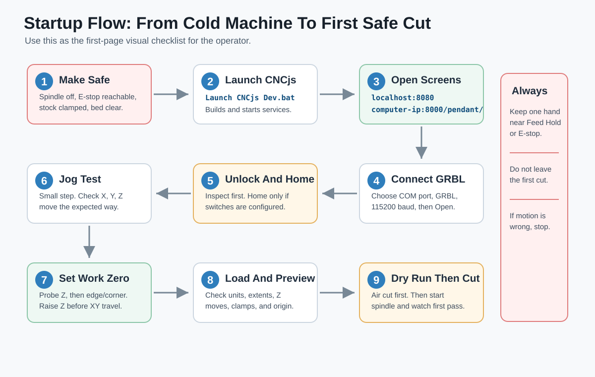
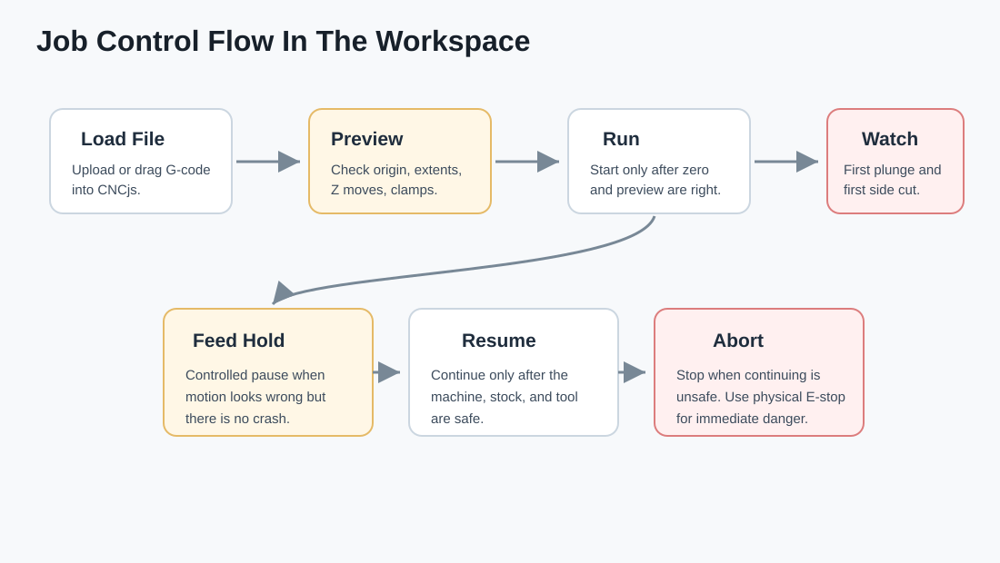

# Visual Startup Guide

This is the quick visual guide for a new operator. Use it before the detailed manual.

## What The Operator Should Do First

Start with the physical machine, not the software.

| Check | What Good Looks Like |
| --- | --- |
| Spindle/router | Off before launch, connect, homing, jogging, and probing |
| Emergency stop | Reachable without moving away from the machine |
| Bed | Clear of loose tools, screws, clamps, and offcuts |
| Stock | Firmly clamped, no rocking |
| Tool | Tight in the collet |
| Probe cable | Clear of the gantry and spindle |
| First job | Simple, shallow, and easy to inspect |

## Launch Screen Sequence

1. Run `Launch CNCjs Dev.bat`.
2. Wait for the build and server windows to start.
3. Open the desktop workspace at `http://localhost:8080`.
4. Open the phone pendant at `http://<computer-ip>:8000/pendant/`.
5. Connect the controller from the workspace or pendant.
6. Unlock only after looking at the machine.
7. Home only if homing switches are configured and clear.

## First Safe Motion

Use the smallest practical jog step.

| Motion | What To Watch |
| --- | --- |
| X jog | Gantry/table moves the expected X direction |
| Y jog | Gantry/table moves the expected Y direction |
| Z+ jog | Tool moves away from the stock |
| Z- jog | Tool moves toward the stock slowly and predictably |

If any direction is wrong, stop before probing or cutting.

## First Work Zero

The recommended beginner setup is top front-left stock zero.

1. Jog above the stock top.
2. Probe Z first.
3. Raise Z.
4. Jog near the front-left corner.
5. Run the front-left corner probe.
6. Confirm the DRO makes sense.
7. Raise Z before loading or starting the job.

See [[09 - Probing And Autolevel Visual Reference]] for the probe pad map.

## First Job Flow

| Step | Rule |
| --- | --- |
| Load | Use GRBL-compatible G-code in millimeters |
| Preview | Confirm origin, extents, Z moves, and clamp clearance |
| Air cut | Run above the stock with spindle off for the first test |
| Cut | Start spindle, start job, watch the first plunge and first pass |
| Pause | Use Feed Hold for a controlled pause |
| Danger | Use Abort or physical emergency stop |

## Stop Rules

Use Feed Hold when the motion is suspicious but not immediately dangerous.

Use Abort or the physical emergency stop when:

- The tool is moving toward a clamp.
- The tool is moving the wrong way.
- The stock shifts.
- The probe cable is caught.
- The spindle/router or cutter sounds wrong.

