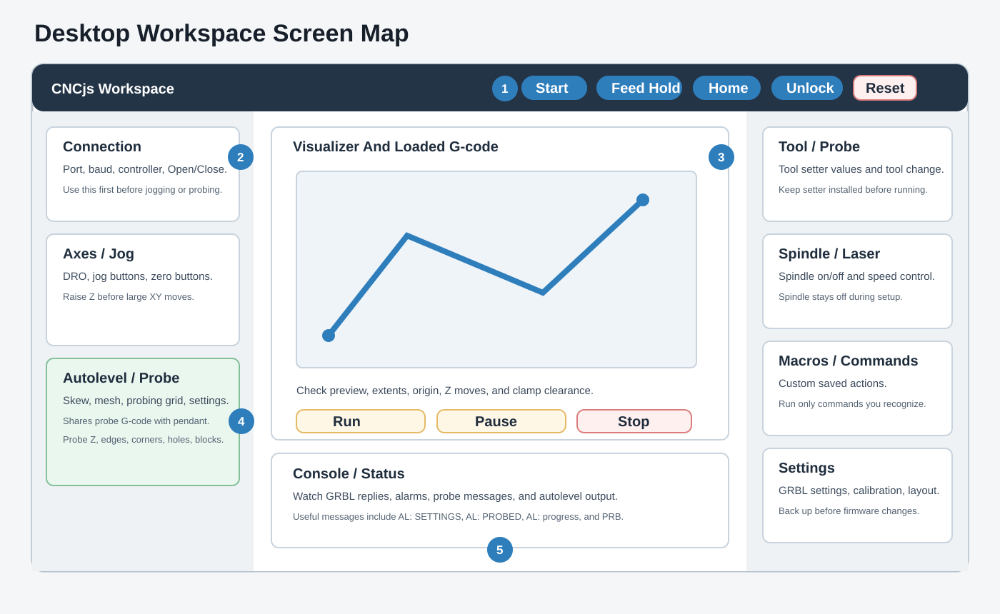
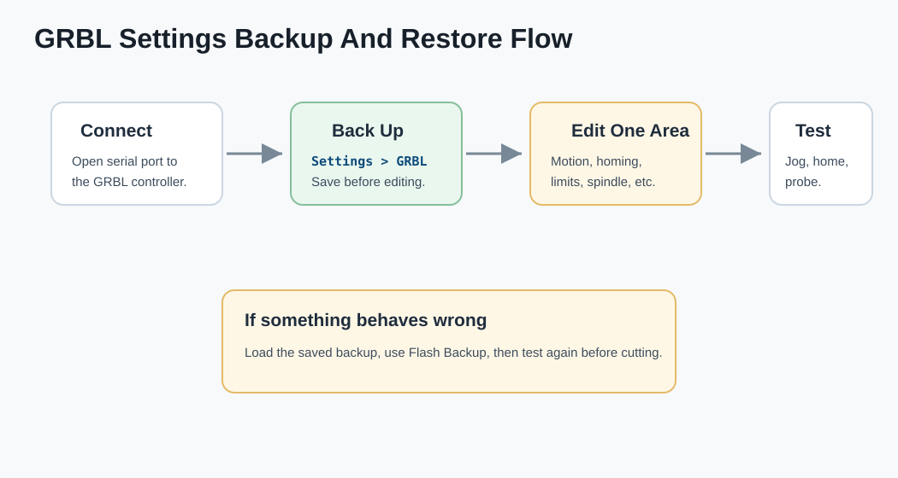

# Workspace Visual Reference

The desktop workspace is the main control room. Use it for connection, setup, G-code preview, probing, settings, and job control.

## 1. Top Bar And Quick Controls

| Area | Purpose | Operator Notes |
| --- | --- | --- |
| Cycle Start / Run | Starts or resumes motion | Use only after preview and zero are confirmed |
| Feed Hold | Pauses controlled motion | First choice when something looks wrong but is not a crash |
| Homing | Runs homing | Use only when switches and homing are configured |
| Unlock | Clears alarm lock | Inspect machine first |
| Reset | Resets controller | Expect alarm/state changes afterward |

## 2. Connection Widget

Use this before anything else.

| Control | What It Does |
| --- | --- |
| Controller selector | Selects GRBL |
| Port dropdown | Selects the controller COM port |
| Refresh | Reloads the serial port list |
| Baud rate | Usually `115200` |
| Open | Connects CNCjs to the controller |
| Close | Disconnects from the controller |

The workspace and pendant do not jog, probe, home, or run jobs until the serial connection is open.

## 3. Axes And Jogging

The axes widget shows the live work position and machine state.

| Control | Use |
| --- | --- |
| DRO | Read current X, Y, Z position |
| Jog buttons | Move one axis or diagonal XY |
| Jog step | Choose movement size |
| Set X/Y/Z zero | Set the active work coordinate |
| Go to zero | Move back to a work zero position |

Safe habit: raise Z before large X/Y moves.

## 4. Visualizer

The visualizer is the main preview area for the loaded G-code file.

Check these before pressing Run:

1. The file is in millimeters.
2. The toolpath is near the intended work zero.
3. The stock origin matches the CAM setup.
4. Z plunges and retracts look reasonable.
5. The path avoids clamps.
6. The cutter starts where expected.

## 5. Autolevel And Probe Widget

The workspace probe widget is the detailed probing interface.

| Tab | Purpose |
| --- | --- |
| Compensation | Skew measurement, mesh probing, clear/apply skew, clear/apply mesh |
| Probing | Z, edge, corner, hole, block, inner pocket, and tool-change probing |
| Settings | Probe diameter, deflection, feeds, retract, max travel, mesh, skew, and tool setter values |

The workspace calls the same shared probe functions as the pendant. See [[09 - Probing And Autolevel Visual Reference]].

## 6. Tool Widget

Use the Tool widget for tool-probe settings and tool-change routines.

| Setting | Meaning |
| --- | --- |
| Tool Probe X/Y | Machine coordinate of the fixed tool setter |
| Tool Probe Z | Safe approach height for the setter |
| Safe Z Machine | Machine-coordinate safe travel height |
| Travel Speed | Rapid travel feed used in generated routines |

Do not run a tool-change probe unless the tool setter is in place.

## 7. Spindle, Laser, And Coolant

Use spindle/coolant controls only after the machine is positioned safely.

| Control | Meaning |
| --- | --- |
| M3 | Spindle clockwise |
| M4 | Spindle counter-clockwise |
| M5 | Spindle off |
| M7 | Mist coolant |
| M8 | Flood coolant |
| M9 | Coolant off |

Keep the spindle off during setup, jogging, homing, and probing.

## 8. Console And Status

The console is where you confirm controller replies.

Important messages:

| Message | Meaning |
| --- | --- |
| `ok` | GRBL accepted the command |
| `ALARM` | Controller needs attention before motion |
| `[PRB:...]` | Probe result from GRBL |
| `(AL: SETTINGS ...)` | Autolevel settings returned |
| `(AL: PROBED ...)` | Mesh point captured |
| `(AL: progress ...)` | Mesh probe progress |

## 9. Settings

Use Settings for configuration, not normal cutting.

| Settings Area | Use |
| --- | --- |
| Workspace | Import/export/reset layout |
| GRBL Settings | Read, back up, edit, and restore firmware settings |
| Calibration | Calculate/apply `$141` skew factor |
| Machine Profiles | Machine travel/profile records |
| Commands | Custom top-menu commands |
| Events | Commands triggered by app/controller events |
| User Accounts | Login accounts when enabled |

Always back up GRBL settings before changing firmware values.

