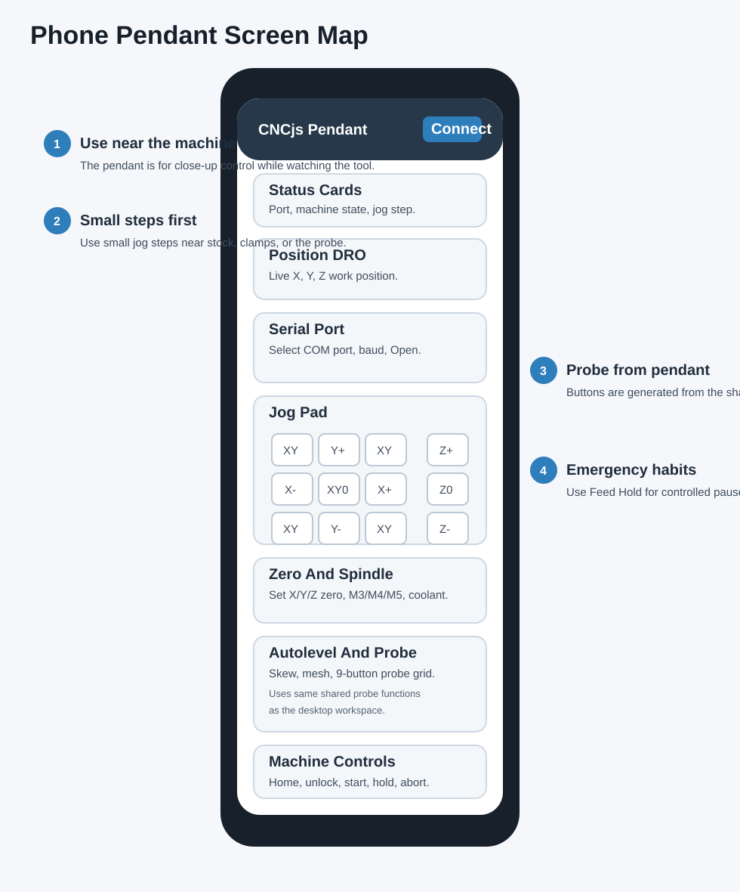
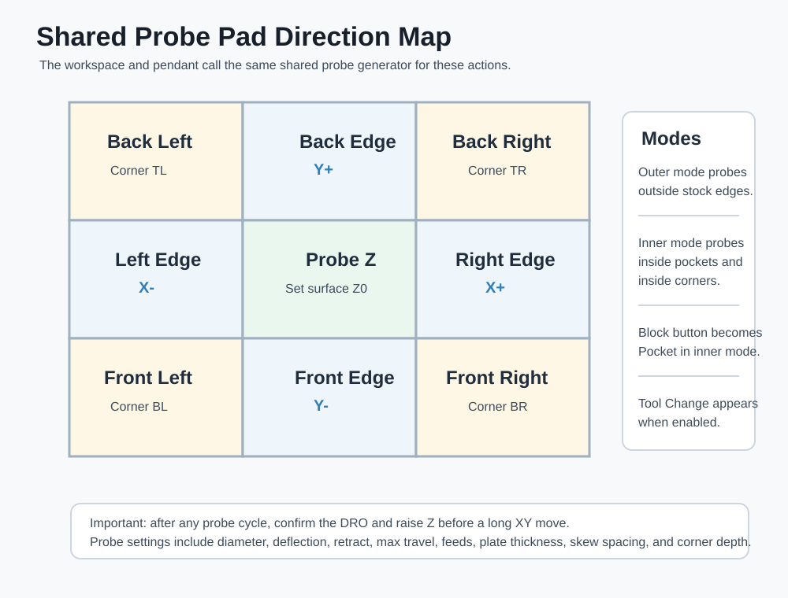

# Phone Pendant Visual Reference

The phone pendant is for close-up control near the CNC router. Use it when you need to watch the tool, stock, probe, and clamps directly.

## 1. Top Bar

| Control | Purpose |
| --- | --- |
| CNCjs Pendant title | Confirms the phone is on the pendant page |
| Connection status | Shows disconnected, connecting, or connected |
| Connect button | Starts or restarts the pendant socket connection |

If the pendant asks for sign-in, use the same CNCjs account/token flow as the workspace.

## 2. Status Cards

| Card | Meaning |
| --- | --- |
| Port | Current controller serial port |
| State | GRBL active state |
| Step | Current jog step |

Confirm the jog step before every close-up motion.

## 3. Position Readout

The pendant shows X, Y, and Z work position. Read this before and after probing.

Good beginner habit:

1. Look at the DRO.
2. Move one small step.
3. Confirm the DRO changed the way you expected.
4. Continue only after the movement makes sense.

## 4. Serial Port Panel

| Control | Purpose |
| --- | --- |
| Port dropdown | Selects the GRBL controller port |
| Refresh | Reloads ports |
| Baud dropdown | Selects baud rate |
| Open | Opens the serial connection |

Use `115200` unless your controller is configured differently.

## 5. Jog Pad

The pendant jog pad is for close-up positioning.

| Area | Use |
| --- | --- |
| Diagonal XY buttons | Move X and Y together |
| X/Y buttons | Move one horizontal axis |
| Z buttons | Move tool up or down |
| XY0 | Move to active X/Y work zero |
| Z0 | Move to active Z work zero |
| Step selector | Controls jog distance |

Raise Z before using XY0 or any long XY movement.

## 6. Zero Panel

| Button | G-code |
| --- | --- |
| Set X0 | `G10 L20 P1 X0` |
| Set Y0 | `G10 L20 P1 Y0` |
| Set Z0 | `G10 L20 P1 Z0` |
| Set XY0 | `G10 L20 P1 X0 Y0` |
| Set XYZ0 | `G10 L20 P1 X0 Y0 Z0` |
| Go To XY0 | `G0 X0 Y0` |

Use probe routines when possible instead of manually guessing zero.

## 7. Spindle And Coolant

| Button | Meaning |
| --- | --- |
| M3 | Spindle clockwise |
| M4 | Spindle counter-clockwise |
| M5 | Spindle off |
| M7 | Mist coolant |
| M8 | Flood coolant |
| M9 | Coolant off |

The spindle speed field is used when sending M3 or M4.

## 8. Autolevel Panel

| Button | Purpose |
| --- | --- |
| Measure Skew | Probe two points and calculate skew angle |
| Clear | Clear stored skew or mesh data |
| Apply Skew | Apply stored skew to the loaded G-code |
| Probe Mesh | Start surface map probing |
| Apply Mesh | Apply stored surface map to the loaded G-code |

Surface mesh and skew are still managed by the CNCjs/autolevel service. The pendant is a close-up control surface for those actions.

## 9. Probing Panel

The pendant probing buttons are generated from the same shared module as the workspace.

| Mode | Use |
| --- | --- |
| Outer | Probe outside stock edges, outside corners, holes, and blocks |
| Inner | Probe inside edges, inside corners, and pocket centers |
| Boss Axis | Chooses X or Y axis for block/boss probing |

Open Probe Settings to review or edit:

- Probe diameter.
- Stock X/Y.
- Probe deflection.
- Retract distance.
- Max travel.
- Safe Z.
- Feed rates.
- Plate thickness.
- Skew spacing.
- Corner depth.
- Tool setter coordinates.

## 10. Machine Panel

| Button | Use |
| --- | --- |
| Home Machine | Run configured homing cycle |
| Unlock | Clear alarm lock after inspection |
| Home X / Home Y / Home Z | Home individual axes |
| Cycle Start | Start/resume workflow |
| Resume | Resume after pause |
| Feed Hold | Controlled pause |
| Abort Job | Stop unsafe job |

The phone is close to the machine, but it is not a replacement for the physical emergency stop.

## 11. Custom Commands And Log

The pendant can load enabled CNCjs custom commands.

Only run a custom command if:

1. You recognize its name.
2. You know what motion or machine action it performs.
3. The machine is clear and safe.

Use the log to confirm connection, command sends, workflow state, and errors.

