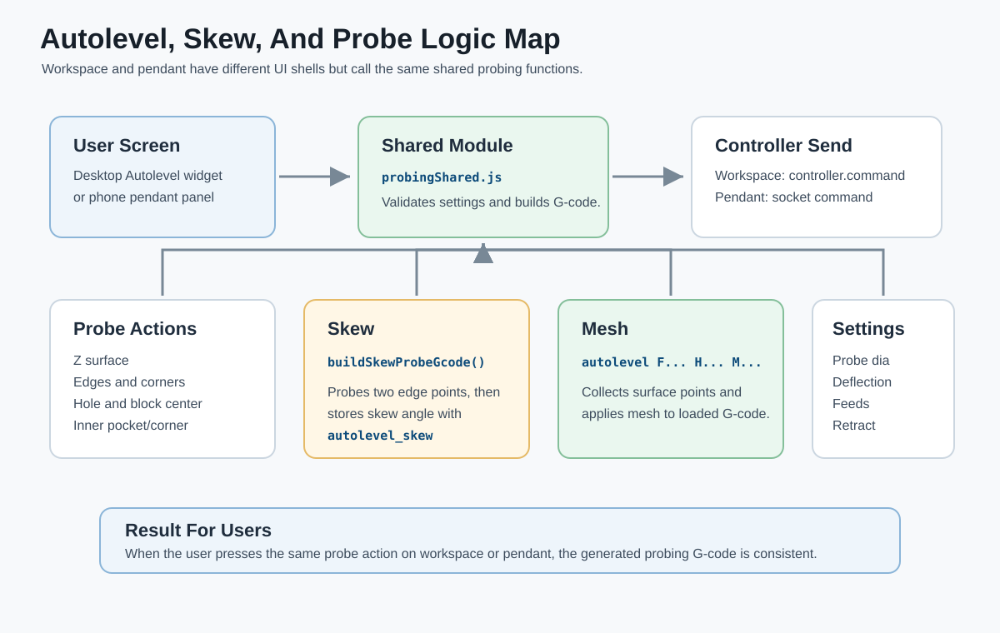
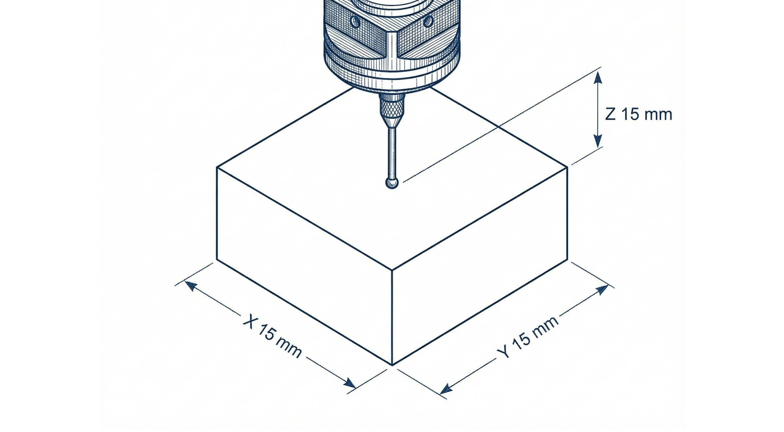
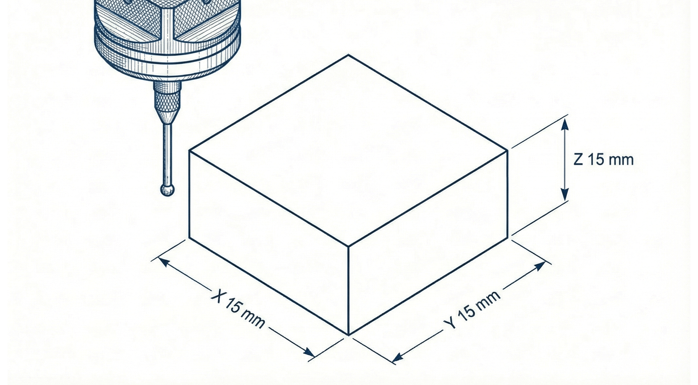
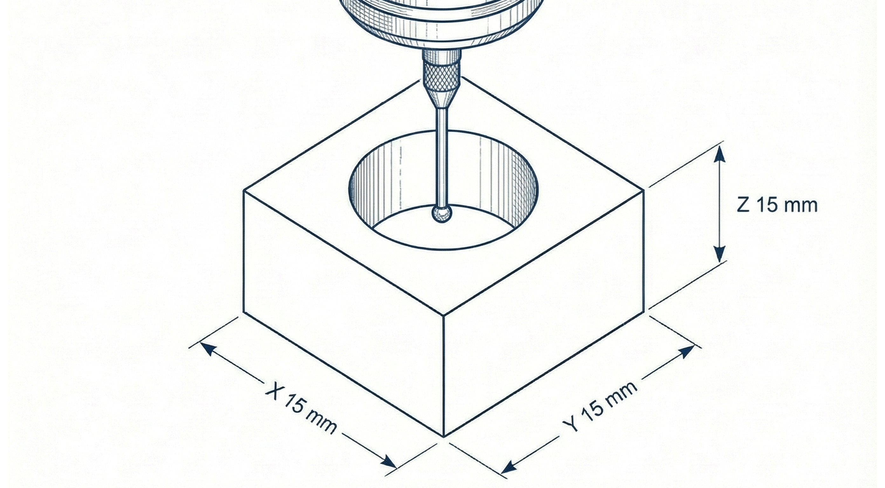
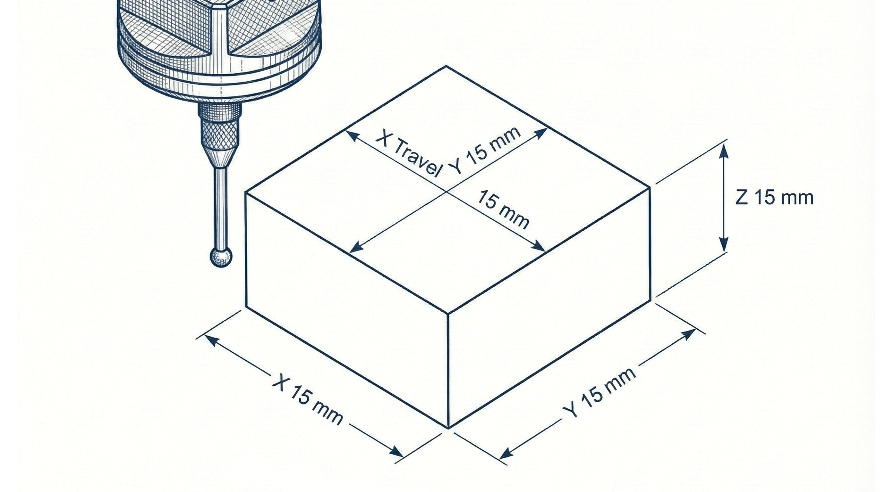
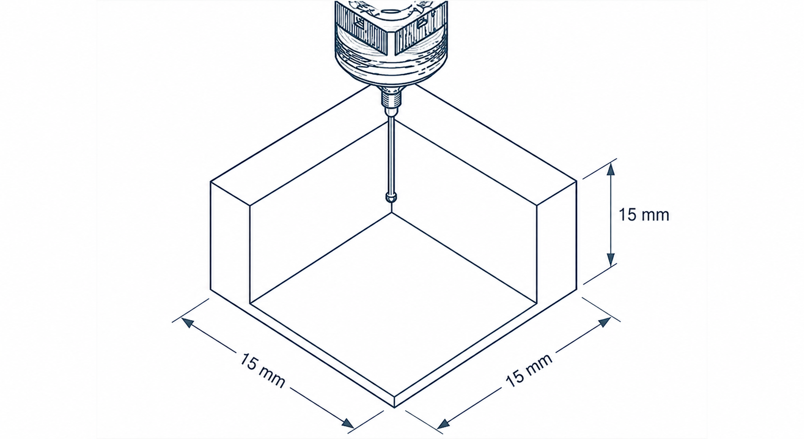
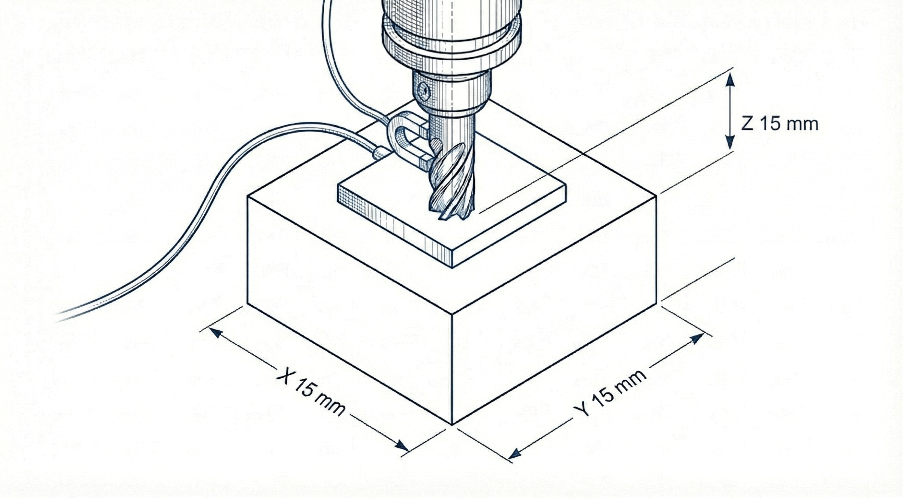
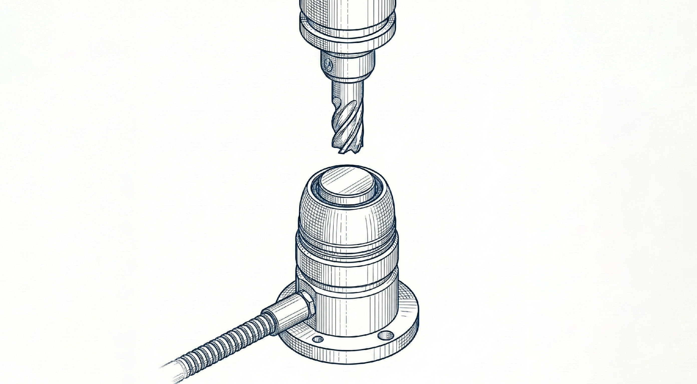

# Probing And Autolevel Visual Reference

This guide explains the shared probing and autolevel behavior used by both the desktop workspace and the phone pendant.

## Shared Function Rule

The workspace and pendant use different user interfaces, but the probe G-code is generated from the same shared module.

| Surface | Shared Calls |
| --- | --- |
| Workspace Autolevel widget | `validateSettings`, `generateProbe`, `buildSkewProbeGcode` |
| Phone pendant | `validateSettings`, `getVisibleProbeButtons`, `generateProbe`, `buildSkewProbeGcode` |

This keeps the two screens consistent.

## Probe Pad

| Button | Typical Use |
| --- | --- |
| Probe Z | Set the top surface Z zero |
| Back/Front/Left/Right edge | Set one XY edge |
| Corners | Set X and Y from a selected stock corner |
| Hole | Find center of a circular feature |
| Block | Find center of an outside boss/block |
| Pocket | Find center of an inside pocket in Inner mode |
| Z Touchplate | Set Z using a touchplate thickness |
| Tool Change | Probe current tool, pause, probe new tool, adjust Z |

## Probe Instruction Images

These are the visual instruction images used by the app.

### Corner

### Edge

### Hole

### Block Or Boss

### Inner Corner

### Z Touchplate

### Tool Change

## Probe Settings

| Setting | Meaning |
| --- | --- |
| Height | Surface-map travel height between points |
| Margin | Offset from stock edge for mesh points |
| Grid Size | Number of points in X/Y surface map |
| Probe Dia | Physical probe tip/shank diameter |
| Stock X / Stock Y | Approximate workpiece size |
| Deflection | Probe trigger overshoot offset |
| Retract | Pull-away distance after contact |
| Max Travel | Maximum probe search distance |
| Safe Z | Safe rapid height |
| Slow Feed | Fine probing feedrate |
| Fast Feed | Initial probing feedrate |
| Plate Thick. | Touchplate thickness |
| Skew Spacing | X distance between skew probe points |
| Corner Depth | Z plunge depth for inner probing |
| Tool Probe X/Y/Z | Fixed tool setter machine position |
| Safe Z (Mach) | Machine-coordinate safe travel height |
| Travel Speed | Rapid feed used for tool-change movement |

## Standard Safe Probe Flow

1. Connect to GRBL.
2. Confirm the machine is idle.
3. Confirm the probe is plugged in and working.
4. Set probe settings.
5. Jog to the correct start position.
6. Run the probe.
7. Confirm the machine retracts.
8. Confirm the DRO result.
9. Raise Z before any long XY move.

## Surface Mesh Flow

1. Load or prepare the G-code file.
2. Confirm work zero.
3. Set mesh height, margin, grid size, and feeds.
4. Start Probe Mesh.
5. Watch progress messages.
6. When complete, inspect mesh point count/range.
7. Apply Mesh to the loaded G-code if the result makes sense.

## Skew Flow

1. Position the probe at the first edge point.
2. Start Measure Skew.
3. The machine probes point 1.
4. The machine moves along X by Skew Spacing.
5. The machine probes point 2.
6. The app calculates skew angle.
7. Store or apply the result.

## Tool Change Flow

Only use this when the tool setter is installed and clear.

1. Move to the tool setter machine coordinates.
2. Probe the current tool.
3. Pause for manual tool change.
4. Probe the new tool.
5. Adjust Z offset to preserve the original cut depth.

## Troubleshooting

| Symptom | Likely Cause | Action |
| --- | --- | --- |
| Probe does not stop | Probe input not wired or GRBL probe setting wrong | Stop immediately and test probe input |
| Probe fails before touch | Probe already triggered | Check wiring, cable, and `$6` invert probe pin |
| XY zero is offset wrong | Probe diameter or deflection wrong | Recheck Probe Dia and Deflection |
| Inner probe cuts too deep | Corner Depth too large | Reduce Corner Depth |
| Mesh looks strange | Wrong zero, loose stock, bad probe contact | Clear mesh, re-zero, and re-probe |

